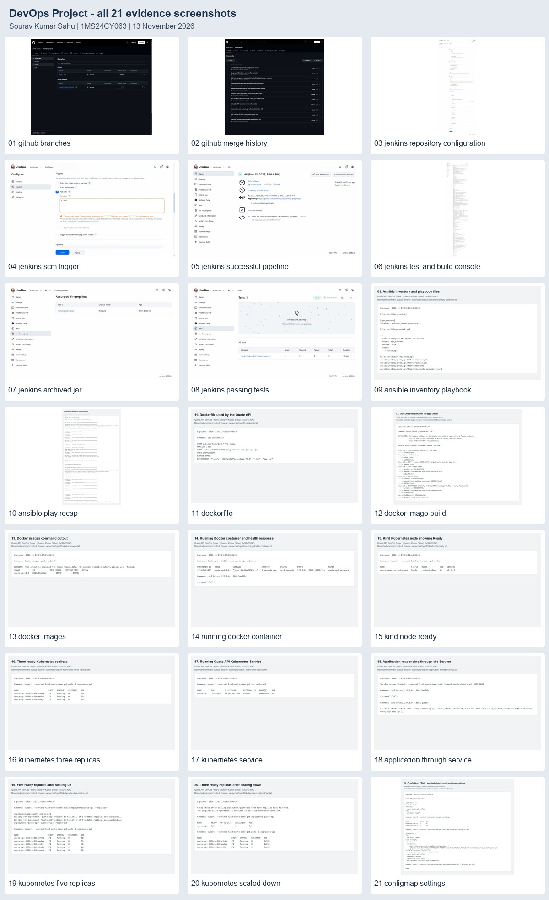

# Screenshot evidence - 21/21

Captured on 13 November 2026 for Sourav Kumar Sahu, USN 1MS24CY063.

This folder covers every item in the supplied screenshot checklist. The actual project uses **Quote API**, Service **quote-api**, and the **Kind** cluster `quote-demo`. Those names replace the checklist's example `todo-service` and Minikube names.

Screenshots 01-08 show the real GitHub and Jenkins interfaces. Screenshots 09-21 show readable browser views of actual recorded command output, explicitly labelled as recorded output. The full text is included in [logs](logs/) so the images can be checked against the commands and results. The screenshots are not simulated terminal sessions.

## Component 1 - Git, Maven and Jenkins

| # | Checklist item | Screenshot |
| --- | --- | --- |
| 01 | GitHub main and feature branches | [Branches](01-github-branches.jpg) |
| 02 | GitHub commit history showing the merge | [Merge history](02-github-merge-history.jpg) |
| 03 | Jenkins job configuration with GitHub repository | [Repository configuration](03-jenkins-repository-configuration.jpg) |
| 04 | Jenkins SCM polling/build trigger configuration | [SCM trigger](04-jenkins-scm-trigger.jpg) |
| 05 | Successful Jenkins pipeline execution | [Successful build](05-jenkins-successful-pipeline.jpg) |
| 06 | Jenkins console showing Test and Build stages | [Complete console output](06-jenkins-test-and-build-console.jpg) |
| 07 | Jenkins archived JAR artifact | [Archived JAR fingerprint](07-jenkins-archived-jar.jpg); its download link and size are also visible in 05 |
| 08 | Successful automated tests as the CI enhancement | [Three passing tests](08-jenkins-passing-tests.jpg) |

Jenkins build **#6** was started by an SCM change for commit `7568c28`. It completed with **SUCCESS**, passed all three tests with zero failures or skips, and archived `target/quote-api.jar`. The [result metadata](logs/jenkins-result.json), [complete build console](logs/jenkins-build-6.txt), and [actual job configuration](logs/jenkins-job.xml) are included.

## Component 2 - Ansible, Docker and Kubernetes

| # | Checklist item | Screenshot |
| --- | --- | --- |
| 09 | Ansible inventory and playbook files | [Inventory, playbook and role files](09-ansible-inventory-playbook.jpg) |
| 10 | Successful Ansible execution and PLAY RECAP | [Two successful runs](10-ansible-play-recap.jpg) |
| 11 | Dockerfile | [Actual Dockerfile](11-dockerfile.jpg) |
| 12 | Successful Docker image build | [Image build](12-docker-image-build.jpg) |
| 13 | Docker images command output | [Image list](13-docker-images.jpg) |
| 14 | Running Docker container | [Container and health response](14-running-docker-container.jpg) |
| 15 | Kubernetes node showing Ready | [Kind node Ready](15-kind-node-ready.jpg) |
| 16 | Three replicas before scaling | [Three ready pods](16-kubernetes-three-replicas.jpg) |
| 17 | Kubernetes Service output | [Quote API Service](17-kubernetes-service.jpg) |
| 18 | Application responding through the Service | [Service HTTP responses](18-application-through-service.jpg) |
| 19 | Five replicas after scaling up | [Five ready pods](19-kubernetes-five-replicas.jpg) |
| 20 | Three replicas after scaling down | [Final three-pod state](20-kubernetes-scaled-down.jpg) |
| 21 | ConfigMap YAML and applied ConfigMap output | [ConfigMap and container environment](21-configmap-settings.jpg) |

Both Ansible runs finished with `failed=0`; the unchanged repeat run reported `changed=0`. Kubernetes finished with three ready pods after the five-pod demonstration. Screenshot 20 shows the settled state after the surplus pods were removed; the earlier [scale-down transition](logs/20-scale-down-transition.txt) is retained separately.

The [ConfigMap](../k8s/configmap.yaml) supplies `APP_PORT=8080` through the Deployment's `envFrom`. Screenshot 21 includes both the applied object and the value read from the running container. The existing health probes remain enabled.

The November 7 report evidence remains under `reports/evidence/`; these numbered captures are the complete November 13 checklist set.
