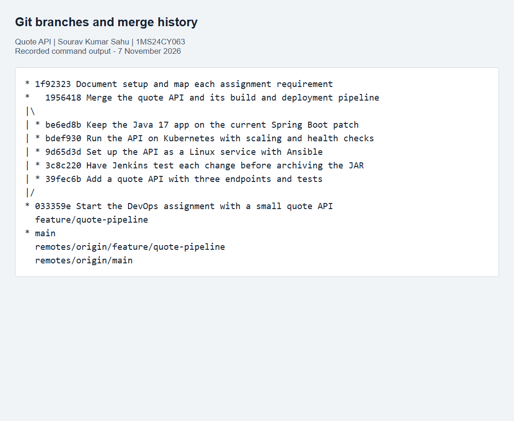
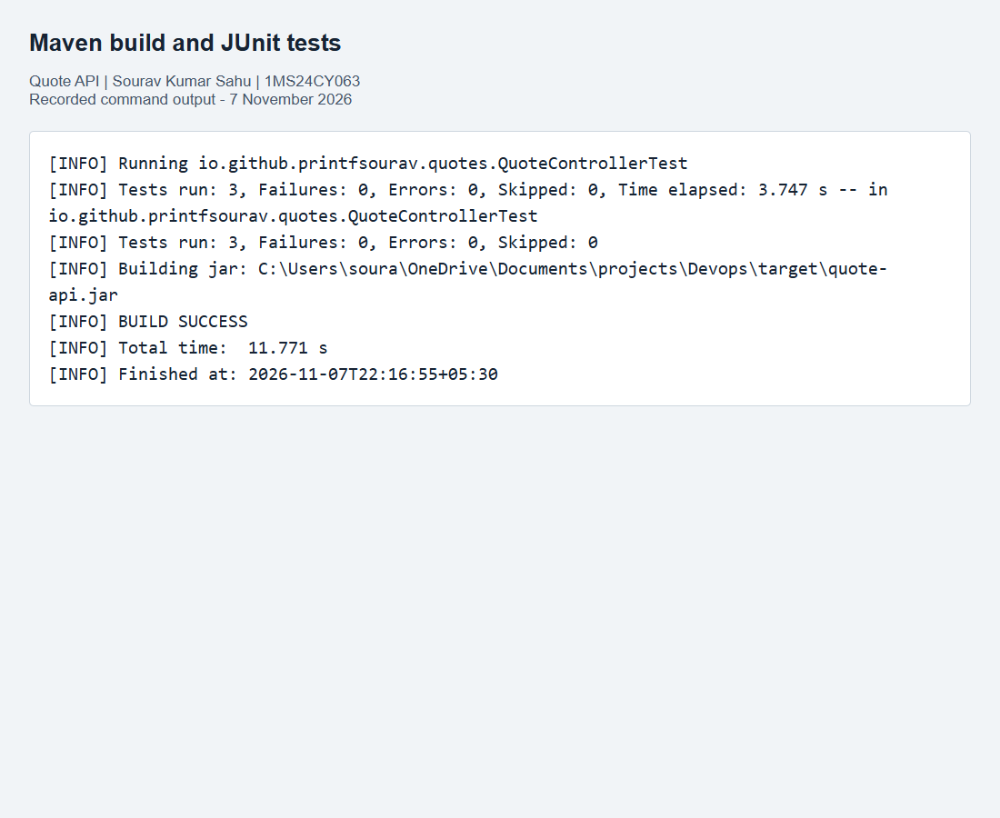
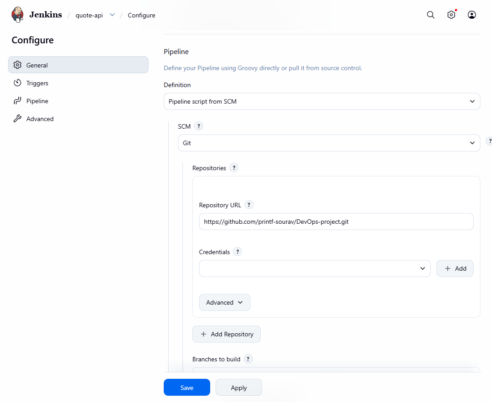
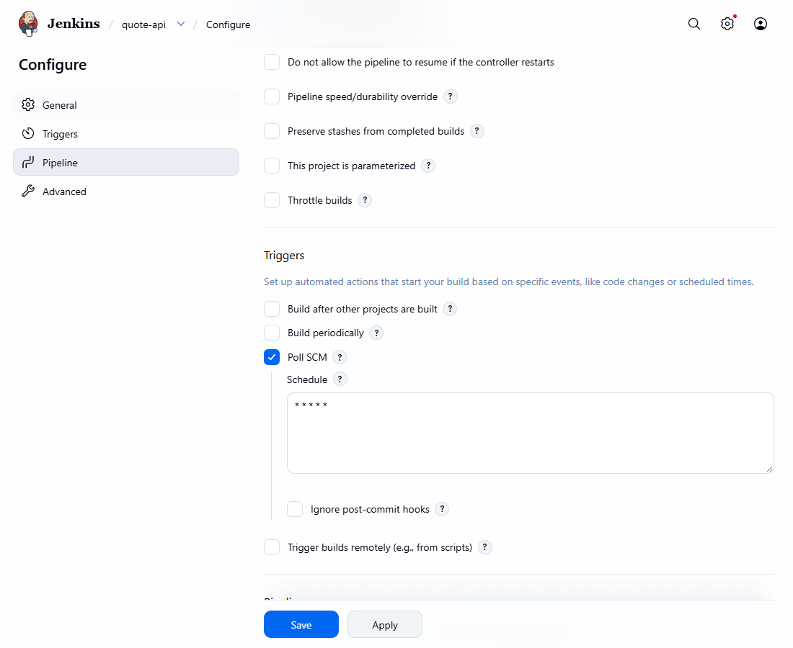
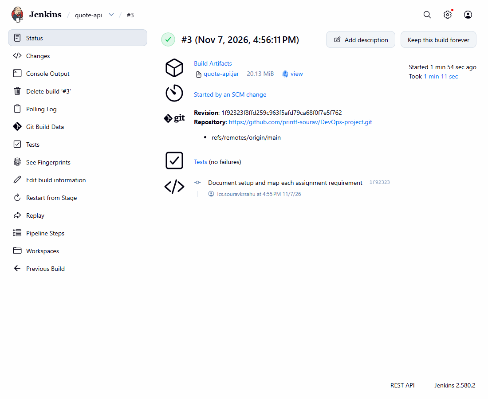
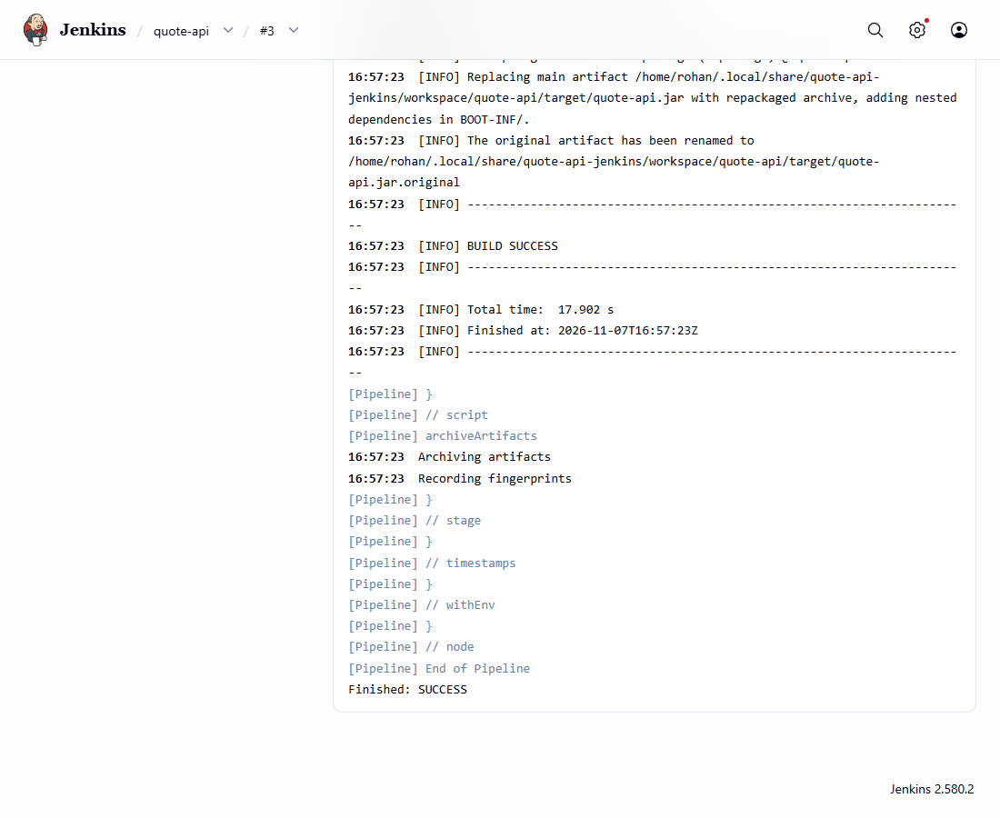
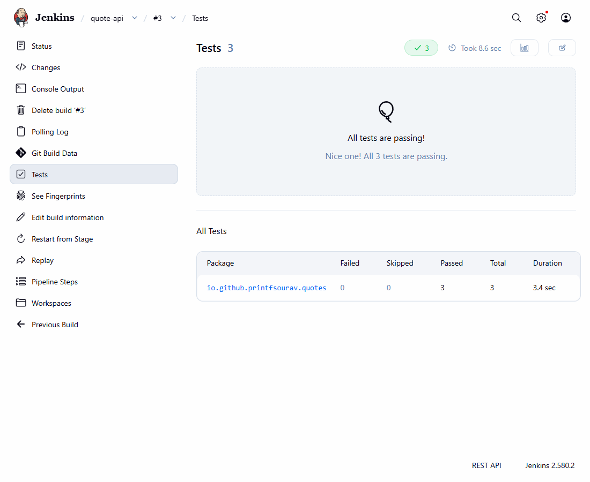

# Component 1: CI Pipeline with Git, Maven and Jenkins

**Quote API DevOps Project**

Submitted by: Sourav Kumar Sahu  
USN: 1MS24CY063  
Course: DevOps - 25CIAEC59 / 25CYAEC59  
Component: 1 (10 marks)  
Repository: https://github.com/printf-sourav/DevOps-project

---page---

## Certificate page - draft for faculty review

Project: Quote API DevOps Project, Component 1.

Student: Sourav Kumar Sahu. USN: 1MS24CY063.

This page is reserved for the institution's prescribed certificate. The assignment refers to a separate title-page and certificate template, but that template was not included in the supplied five-page document. Replace this page and the cover with the official format before submission. This draft does not represent faculty approval or certification.

Institution / Department: ______________________________

Course coordinator: __________________________________

Faculty signature: ____________________________________

Date: ______________________________________________

---page---

## Abstract

This component builds a small REST API and puts its build process under continuous integration. The application returns a fixed list of quotes, a random quote, and a health response. Git tracks the source, Maven compiles and packages it into an executable JAR, and Jenkins polls the GitHub repository for changes. The pipeline runs three automated tests before packaging and archives the JAR after a successful build. The small application makes it easy to follow the path from a source change to a tested artifact.

## Introduction

A manual build depends on someone remembering to run the correct commands after each change. Continuous integration repeats those checks automatically. This project uses one repository and one application for both assignment components. Component 1 produces the JAR that Component 2 installs as a Linux service and packages in a Docker image.

The application deliberately has no database, authentication system or frontend. Its purpose is to demonstrate version control, a repeatable Maven build, an automatic Jenkins trigger, artifact archiving and an implemented CI enhancement.

## Implementation

### Development environment

Application: Java 17, Spring Boot 3.5.16, Maven and JUnit. Version control: Git and GitHub. CI: Jenkins LTS with Pipeline, Git, JUnit and Timestamper plugins. The local build used JDK 17; Jenkins runs in Ubuntu WSL with Java 21 and can compile the same Java 17 target. All tools are available without a paid cloud account.

### Application code

`src/main/java/io/github/printfsourav/quotes/QuoteApplication.java` starts Spring Boot. `QuoteController.java` contains an immutable list of three quote records and the three HTTP routes. Each record has an integer ID and a text field. Spring's JSON support serializes the records and the health response.

- `GET /quotes`: returns all three quotes.
- `GET /quotes/random`: returns one item from the same list.
- `GET /health`: returns `{"status":"UP"}`.

`application.properties` reads the port from `APP_PORT`, defaulting to 8080. No data is written to disk or shared between replicas.

### Git and Maven

The repository keeps a main branch and a feature branch named `feature/quote-pipeline`. Application, CI and deployment changes were committed on the feature branch and merged with a non-fast-forward merge commit. Both branches are retained on GitHub so the branch and merge history can be inspected.

`pom.xml` declares the web dependency, test dependency, Java release and Spring Boot packaging plugin. `mvn clean package` compiles the code, runs tests, and produces `target/quote-api.jar`. The JAR starts with `java -jar target/quote-api.jar`.

### Jenkins job and pipeline

The Pipeline job reads `Jenkinsfile` from this Git repository and the main branch. SCM polling uses `* * * * *`, so Jenkins checks once per minute. An initial run loads the Jenkinsfile and registers the trigger; subsequent source changes must be detected through polling to demonstrate CI.

The Test stage runs `mvn -B clean test`. Its post action publishes `target/surefire-reports/*.xml`. Only a successful Test stage reaches Build, which runs `mvn -B -DskipTests package`. The second command avoids repeating tests already passed in the same workspace. `archiveArtifacts` saves `target/quote-api.jar` with a fingerprint. Concurrent builds are disabled and the last ten runs are retained.

## Chosen enhancement: automated tests in CI

The enhancement is a separate Test stage before Build. Three tests check the list response, verify that a random response belongs to the known list, and check the health response. These tests exercise HTTP routing and JSON serialization through MockMvc without needing an external server.

This enhancement was chosen because it catches a broken response before Jenkins publishes an artifact, with very little extra setup. As a verification of test usefulness, the health response was temporarily changed to DOWN. The health test failed, and the original code was restored before the successful final build.

---page---

## Results

The local Maven build completed successfully with three tests, zero failures and zero skipped tests. The packaged application returned valid JSON for all three endpoints. The Git evidence records both retained branches and their merge commit.

The evidence folder contains the recorded command output and Jenkins UI captures. Command-output figures are rendered transcripts of actual runs, not simulated terminal sessions. The Jenkins result file records the build number, result, cause, test counts and archived artifact. A successful run whose cause is an SCM change is the evidence of automatic CI.

Jenkins build #3 completed with SUCCESS after the documentation commit was pushed to main. Its recorded cause is "Started by an SCM change". The published report contains three passed tests, zero failures and zero skipped tests, and the archived artifact is `quote-api.jar`. This confirms polling, testing, packaging and archiving in an actual Jenkins run.

## Conclusion

The project connects version control to an automated test-and-build job. Each build starts from the repository, checks the API and produces a runnable JAR. The test stage is the CI enhancement, while the archived artifact is the handoff to the deployment component. The setup guide documents how to reproduce the job and verify that a pushed change triggers it automatically.

The institutional cover/certificate format and the coordinator's collaborator invitation remain administrative submission steps. The coordinator's GitHub username must be confirmed before inviting an account.

## Resume line

Automated a Java REST API's Maven build in Jenkins with SCM polling, three JUnit tests and archived JAR artifacts.

## References

- Assignment brief: DevOps, course 25CIAEC59 / 25CYAEC59, Components 1 and 2.
- Spring Boot system requirements: https://docs.spring.io/spring-boot/3.5/system-requirements.html
- Maven build lifecycle: https://maven.apache.org/guides/introduction/introduction-to-the-lifecycle.html
- Jenkins Pipeline syntax: https://www.jenkins.io/doc/book/pipeline/syntax/
- Jenkinsfile and artifact archiving: https://www.jenkins.io/doc/book/pipeline/jenkinsfile/
- Jenkins JUnit step: https://www.jenkins.io/doc/pipeline/steps/junit/
- Source repository: https://github.com/printf-sourav/DevOps-project
