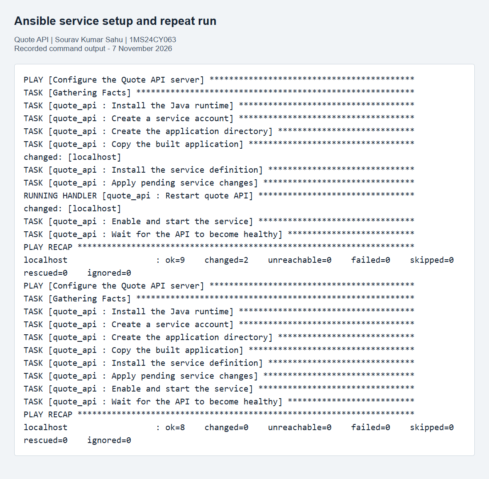
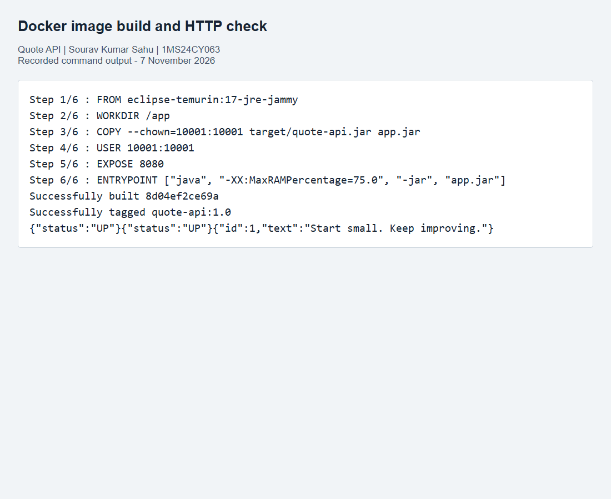
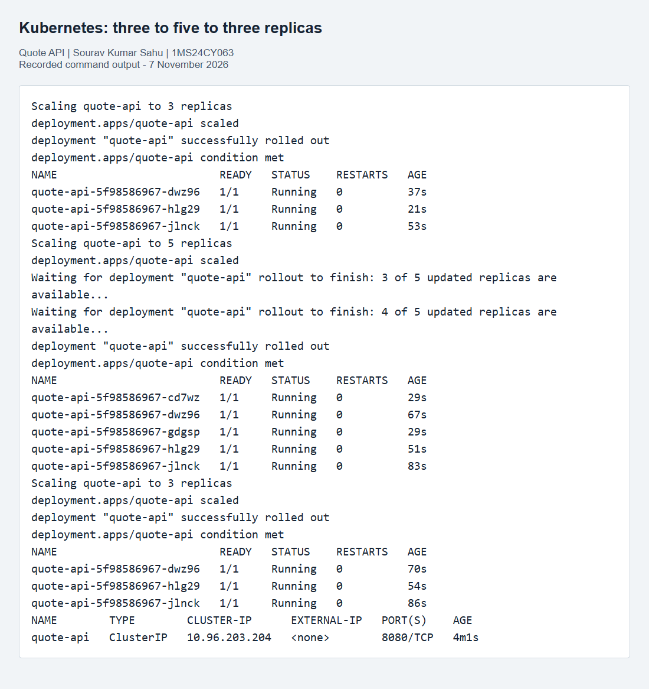
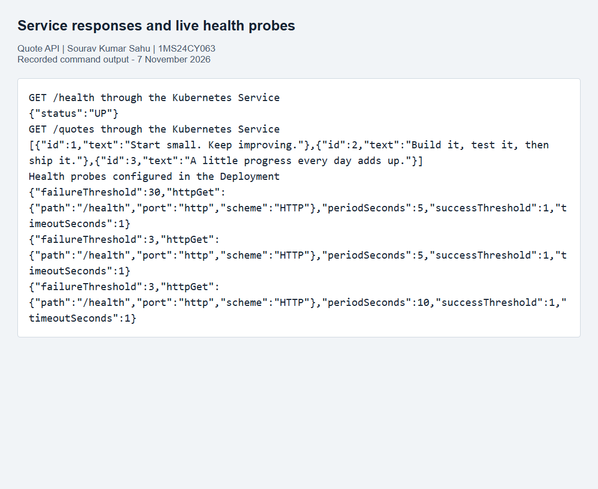

# Component 2: Ansible and Kubernetes Deployment

**Quote API DevOps Project**

Submitted by: Sourav Kumar Sahu  
USN: 1MS24CY063  
Course: DevOps - 25CIAEC59 / 25CYAEC59  
Component: 2 (10 marks)  
Repository: https://github.com/printf-sourav/DevOps-project

---page---

## Certificate page - draft for faculty review

Project: Quote API DevOps Project, Component 2.

Student: Sourav Kumar Sahu. USN: 1MS24CY063.

This page is reserved for the institution's prescribed certificate. The assignment refers to a separate title-page and certificate template, but that template was not included in the supplied five-page document. Replace this page and the cover with the official format before submission. This draft does not represent faculty approval or certification.

Institution / Department: ______________________________

Course coordinator: __________________________________

Faculty signature: ____________________________________

Date: ______________________________________________

---page---

## Abstract

This component deploys the same Quote API built in Component 1. An Ansible role prepares an Ubuntu host, installs Java, copies the executable JAR and starts a systemd service. Docker packages that JAR with a Java runtime. A local Kind Kubernetes cluster runs three replicas behind a Service. The demonstration scales the deployment to five replicas and back to three. Startup, readiness and liveness probes use the API's health route as the deployment enhancement.

## Introduction

A successful build is useful only when the application can also be installed and run consistently. Ansible records the server setup as repeatable tasks. Docker provides a portable runtime package. Kubernetes manages the running containers, routes traffic and changes the number of replicas. These steps extend the same application's pipeline rather than introducing a separate application.

## Implementation

### Development environment

The application targets Java 17 and uses the Maven-built `target/quote-api.jar`. The server demonstration uses Ubuntu under WSL2 with systemd and Ansible Core. The container and cluster demonstration uses a Linux Docker Engine, Kind 0.31.0 and Kubernetes 1.35.0. Docker Desktop was unavailable during setup, so the working Docker engine runs inside Ubuntu WSL. This is still a fully local environment with no paid infrastructure.

### Ansible code and configuration

`ansible/inventory` contains one host, localhost, with a local connection. `playbook.yml` applies the `quote_api` role with privilege escalation. The role was initialized with `ansible-galaxy role init quote_api`; unused scaffold directories were omitted from the finished source.

The role's defaults set `app_port` to 8081, an installation directory under `/opt`, a service account, and the path to the built JAR. Its tasks install `openjdk-17-jre-headless`, create an unprivileged account and directory, copy the artifact, and render a systemd unit. Changes to the JAR or unit notify the restart handler. The role enables the service and retries the health request until it returns UP.

The service template passes `APP_PORT`, starts `/usr/bin/java -jar`, restarts on failure and applies basic systemd restrictions. Port 8081 lets this service coexist with the local application and Jenkins. Repeating the playbook without changes should leave the machine unchanged.

### Docker image

The Dockerfile starts from `eclipse-temurin:17-jre-jammy`, copies only the packaged JAR, and runs it as numeric user 10001. The Java process listens on container port 8080. The Docker build context excludes all unrelated files through `.dockerignore`. Maven is not installed in the runtime image.

The image is built with `docker build -t quote-api:1.0 .` and tested locally before loading it into Kind. The same artifact is used for the Linux service and the container.

### Kubernetes code and deployment

`k8s/deployment.yaml` starts three replicas and matches pods using `app: quote-api`. Each pod runs `quote-api:1.0` with a non-root security context and CPU/memory requests and limits. `k8s/service.yaml` creates a ClusterIP Service whose selector matches those labels. Its port 8080 targets the container port named `http`.

`scripts/deploy.sh` loads the local image into the dedicated Kind cluster, applies both manifests, waits for rollout and lists the pods and Service. The explicit `kind-quote-demo` context keeps these commands scoped to the demo cluster. A service port-forward exposes the API on localhost:8083 for HTTP checks.

### Scaling demonstration

`scripts/scale-demo.sh` sets the replica count to three, then five, then three. At each step it waits for rollout and the expected replica count before listing pods. The recorded output shows the number and health of the running replicas. This is manual scaling; an autoscaler is not part of the implementation.

## Chosen enhancement: health probes

The Deployment includes readiness and liveness probes that request `/health`. Readiness keeps a pod out of Service traffic until it can answer. Liveness lets Kubernetes restart a container that stops answering. A startup probe gives a newly launched JVM time to initialize before liveness checks begin.

This enhancement was chosen because it uses an existing small endpoint, improves the running deployment and can be inspected directly in the live pod specification. The JSON health route is an HTTP status check; it is not a Prometheus metrics exposition endpoint.

---page---

## Results

The Ansible run installed and started the service with zero failed tasks. A second unchanged run reported `changed=0` and `failed=0`. The Docker image built successfully and returned UP plus a valid quote response. Kubernetes ran three healthy pods, scaled to five healthy pods, and returned to three. Requests through the Kubernetes Service returned the health response and quote list.

Command-output figures below are rendered transcripts of actual runs. Their source text is included in the evidence folder so the screenshots can be checked against the recorded results.

## Conclusion

The same tested JAR was installed as a Linux service and packaged for a local Kubernetes cluster. The Ansible role provides repeatable configuration, the Service provides a stable route, and the scaling demonstration changes capacity without changing application code. Health probes provide a small, practical deployment enhancement.

The official cover/certificate and the course coordinator's GitHub invitation still need the institution's template and confirmed username. The source, commands and recorded deployment evidence are included in the repository.

## Resume line

Configured a Java API service with an Ansible role and handlers, then containerized and deployed it on Kubernetes with health probes and manual scaling from three to five replicas.

## References

- Assignment brief: DevOps, course 25CIAEC59 / 25CYAEC59, Components 1 and 2.
- Ansible roles: https://docs.ansible.com/projects/ansible/latest/playbook_guide/playbooks_reuse_roles.html
- Ansible systemd service module: https://docs.ansible.com/projects/ansible/latest/collections/ansible/builtin/systemd_service_module.html
- Dockerfile reference: https://docs.docker.com/reference/dockerfile/
- Kind quick start: https://kind.sigs.k8s.io/docs/user/quick-start/
- Kubernetes Deployments: https://kubernetes.io/docs/concepts/workloads/controllers/deployment/
- Kubernetes probes: https://kubernetes.io/docs/tasks/configure-pod-container/configure-liveness-readiness-startup-probes/
- Source repository: https://github.com/printf-sourav/DevOps-project
